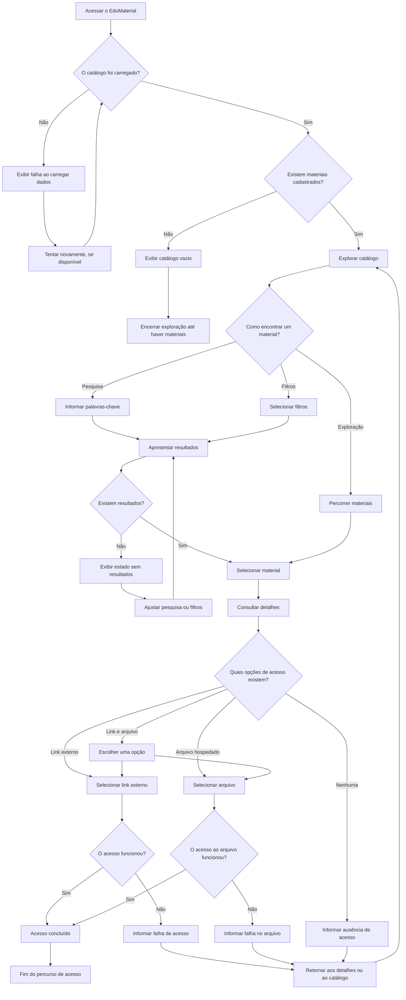

# User Flow — EduMaterial

**Versão:** 0.5  
**Status:** Consolidado para orientar o design do MVP  
**Escopo:** MVP do EduMaterial

## 1. Objetivo

Representar os percursos de um professor que deseja encontrar, avaliar inicialmente e acessar materiais educacionais por meio do EduMaterial.

O fluxo contempla:

- exploração do catálogo;
- pesquisa textual;
- aplicação e ajuste de filtros;
- consulta aos detalhes de um material;
- acesso por link externo, arquivo hospedado ou ambas as opções;
- situações em que não há opção de acesso disponível;
- recuperação após resultados vazios ou falhas.

Este documento descreve o comportamento pretendido para o MVP. Não representa funcionalidades implementadas ou validadas com usuários reais.

## 2. Usuário principal

O usuário prioritário é o professor que procura materiais didáticos para utilizar em suas aulas.

O fluxo deve permitir que ele encontre recursos potencialmente relevantes, compreenda as informações disponíveis, identifique as opções de acesso e consiga continuar a navegação quando a busca não produzir resultados ou quando ocorrer uma falha.

## 3. Fluxo principal

O fluxo começa no catálogo. O usuário pode explorar os materiais diretamente, pesquisar por palavras-chave ou aplicar filtros.

O diagrama representa os percursos previstos. A detecção automática de falhas, a possibilidade de tentar novamente e o comportamento técnico de abertura de arquivos ainda dependem de especificação.

## 4. Descrição das etapas

| Etapa | Ação do usuário | Resposta esperada do sistema |
|---|---|---|
| Acesso inicial | Entra no EduMaterial | Carrega e apresenta o catálogo, quando disponível |
| Catálogo vazio | Acessa um catálogo sem materiais cadastrados | Informa que não existem materiais para exibição |
| Exploração | Percorre a listagem | Apresenta os materiais sem exigir pesquisa prévia |
| Pesquisa | Informa palavras-chave | Apresenta materiais correspondentes às regras de pesquisa |
| Filtragem | Seleciona critérios | Restringe os materiais conforme os filtros aplicados |
| Ajuste da consulta | Altera termos ou filtros | Atualiza os resultados de acordo com os critérios atuais |
| Ausência de resultados | Não encontra correspondências | Informa a situação e orienta a revisão da consulta |
| Seleção | Escolhe um material | Abre os detalhes do recurso selecionado |
| Consulta aos detalhes | Analisa as informações | Apresenta os metadados disponíveis e as opções de acesso cadastradas |
| Acesso externo | Seleciona um link | Tenta abrir o endereço externo cadastrado |
| Acesso por arquivo | Seleciona um arquivo | Disponibiliza o comportamento de abertura ou download definido para o formato |
| Duas opções de acesso | Escolhe entre link e arquivo | Apresenta as opções de forma distinta |
| Nenhuma opção de acesso | Consulta um material sem link ou arquivo | Informa que não há opção de acesso cadastrada |
| Falha de acesso | Não consegue acessar o recurso | Comunica a falha e orienta o próximo passo, quando possível |

## 5. Percursos de pesquisa e filtragem

### 5.1. Pesquisa textual

A pesquisa deve considerar os seguintes campos, nesta ordem de prioridade para relevância: título, tipo de material, resumo e descrição.

As regras confirmadas são:

- ignorar diferenças entre letras maiúsculas e minúsculas;
- ignorar diferenças de acentuação;
- permitir correspondências parciais;
- exigir que todas as palavras da consulta correspondam ao material (AND), mesmo que apareçam em campos diferentes;
- priorizar campos de maior relevância; em consultas com várias palavras, priorizar materiais que concentram mais palavras em campos de maior prioridade;
- dentro do mesmo campo e em condições equivalentes, priorizar correspondências exatas sobre parciais;
- em empate de relevância, ordenar pelo título em ordem alfabética crescente, normalizando caixa e acentuação, e depois pelo identificador único em ordem crescente.

A busca textual e todos os filtros ativos devem ser atendidos simultaneamente. Limpar o texto da busca mantém os filtros selecionados. Se não houver resultados, a interface informa a situação e permite revisar a consulta; a sugestão automática de correção está fora do escopo do MVP; o usuário pode alterar manualmente a consulta.

O fluxo deve permitir que o professor altere a consulta e veja os resultados correspondentes aos novos termos.

### 5.2. Filtragem

Os filtros previstos são tipo de material e etapa de ensino. As opções de cada filtro são derivadas dos valores existentes no catálogo e atualizadas dinamicamente conforme os demais critérios ativos.

O comportamento definido é:

1. O usuário identifica os filtros disponíveis, apresentados em ordem alfabética e sem contagens individuais.
2. Seleciona uma ou mais opções em cada filtro.
3. As opções dentro do mesmo filtro combinam-se por OR; tipo de material, etapa de ensino e busca textual combinam-se entre si por AND.
4. A listagem e a contagem total de resultados são atualizadas imediatamente.
5. Os filtros ativos são apresentados como marcadores removíveis, permitindo retirar critérios individualmente.
6. A ação “Limpar filtros” remove apenas os filtros de tipo e etapa de ensino e preserva o texto da busca.
7. Se uma opção selecionada se tornar incompatível com os demais critérios, ela permanece selecionada e fica desabilitada no controle, podendo ser removida pelo marcador correspondente.

Em telas maiores, os filtros são listas visíveis com caixas de seleção. Em telas pequenas, o botão “Filtros (N)” abre um painel lateral sobre o catálogo, onde N é o total de valores selecionados. O painel tem seções independentes para tipo de material e etapa de ensino, ambas expandidas inicialmente; o estado de expansão e as seleções são preservados ao fechar e reabrir. O painel pode ser fechado pelo botão de fechar, ao tocar fora ou pelo botão Voltar do dispositivo. Selecionar ou remover filtros mantém o painel aberto e atualiza os resultados sem botão “Aplicar”. Não há busca interna nas opções.

Ao alterar busca ou filtros, a lista retorna ao topo. Os resultados são carregados inicialmente em lotes de até 12, com “Carregar mais” para acrescentar até 12 por vez. Durante o carregamento, o controle exibe “Carregando...”. Em caso de falha, a interface informa “Não foi possível carregar mais materiais” e oferece “Tentar novamente”, preservando os materiais já exibidos. Se os critérios mudarem durante o carregamento, respostas de solicitações antigas são invalidadas e não podem ser adicionadas à lista atual.

## 6. Consulta aos detalhes

Ao selecionar um material, o professor deve acessar uma página de detalhes que organize as informações cadastradas.

Os campos previstos incluem, quando disponíveis:

- título;
- tipo de material;
- etapa de ensino;
- resumo;
- descrição;
- orientações de uso;
- autoria ou fonte;
- condições de utilização;
- link externo;
- arquivo hospedado.

Os campos obrigatórios e opcionais estão definidos na especificação BK-006. Campos opcionais sem valor não devem ser inventados nem bloquear a consulta; a apresentação visual de campos ausentes será definida no Figma.

A consulta aos detalhes não depende de pré-visualização integrada, pois essa funcionalidade está fora do escopo do MVP.

## 7. Percursos de acesso

A interface deve representar corretamente os quatro cenários de acesso.

### 7.1. Somente link externo

1. O usuário abre os detalhes do material.
2. Identifica a opção de acesso externo.
3. Seleciona o link.
4. O navegador tenta abrir o endereço cadastrado.
5. Se o recurso não puder ser acessado, a situação deve ser comunicada quando for possível identificá-la.

A plataforma não deve presumir que todos os problemas ocorridos no destino externo podem ser detectados automaticamente.

### 7.2. Somente arquivo hospedado

1. O usuário abre os detalhes do material.
2. Identifica a opção de acesso ao arquivo.
3. Seleciona a opção.
4. O sistema executa o comportamento definido para o arquivo, como abertura ou download.
5. Se ocorrer uma falha identificável, a interface deve comunicar o problema.

Os formatos aceitos para arquivos hospedados são PDF, DOCX, PPTX, PNG e JPG, com limite de 50 MB por arquivo. O comportamento técnico de abertura ou download será detalhado na implementação.

### 7.3. Link externo e arquivo hospedado

1. O usuário abre os detalhes do material.
2. Identifica as duas opções disponíveis.
3. Compara as opções conforme suas identificações.
4. Seleciona a opção desejada.
5. O fluxo continua pelo percurso correspondente ao tipo de acesso escolhido.

A interface não deve sugerir que o link e o arquivo são necessariamente equivalentes.

### 7.4. Nenhuma opção de acesso disponível

1. O usuário abre os detalhes do material.
2. Consulta as informações descritivas.
3. A interface informa que não há opção de acesso cadastrada.
4. O usuário pode retornar ao catálogo ou selecionar outro material.

A ausência de uma opção de acesso não deve ser confundida com falha técnica, nem gerar um botão que prometa abrir um recurso inexistente.

## 8. Estados alternativos e situações excepcionais

### 8.1. Catálogo vazio

Ocorre quando não existem materiais cadastrados para exibição.

A interface deve informar que o catálogo está vazio. Esse estado é diferente de uma pesquisa sem resultados: no catálogo vazio não há materiais cadastrados; na pesquisa sem resultados, a consulta não encontra correspondências entre os materiais existentes.

### 8.2. Pesquisa ou filtragem sem resultados

Ocorre quando os termos pesquisados e os filtros atuais não retornam materiais correspondentes.

A interface deve informar a situação e permitir revisar os termos ou remover critérios. Quando uma busca não retornar resultados, pode sugerir uma consulta corrigida sem alterar automaticamente o texto original, após avaliação técnica da solução.

### 8.3. Falha ao carregar dados

Ocorre quando o sistema não consegue obter ou apresentar os dados necessários para a interface.

A mensagem deve distinguir a falha de um catálogo vazio. Uma ação para tentar novamente pode ser apresentada quando estiver disponível.

### 8.4. Material sem opção de acesso cadastrada

Ocorre quando o cadastro não contém link externo nem arquivo hospedado.

A interface deve informar a condição, manter as informações descritivas disponíveis e permitir que o usuário continue a navegação.

### 8.5. Link externo indisponível

Pode ocorrer quando o endereço cadastrado está incorreto, o destino está indisponível ou o acesso é impedido por condições externas.

A comunicação da falha deve considerar as limitações da plataforma. A detecção automática e os detalhes técnicos de recuperação serão tratados durante a implementação; a interface deve comunicar apenas falhas que puder identificar.

### 8.6. Arquivo indisponível

Pode ocorrer quando o arquivo não pode ser aberto ou baixado.

A interface deverá comunicar a falha quando ela puder ser identificada. Os detalhes técnicos de detecção e recuperação serão definidos em uma etapa posterior.

## 9. Retorno à navegação

O usuário deve conseguir retornar aos detalhes ou ao catálogo depois de consultar um material, encontrar uma falha ou descobrir que não há opção de acesso cadastrada.

Ao abrir um material e retornar ao catálogo durante a navegação atual, o sistema preserva o texto de busca, os filtros selecionados, a posição de rolagem e o estado de expansão das seções do painel de filtros. Se os critérios não forem alterados, a listagem retorna à posição anterior. Uma atualização da página pode reiniciar esse estado.

## 10. Decisões de experiência

- A pesquisa não deve ser o único caminho para encontrar materiais.
- O professor deve poder explorar o catálogo sem informar palavras-chave.
- A interface deve distinguir catálogo vazio, pesquisa sem resultados e falha ao carregar dados.
- Os filtros ativos devem ser identificáveis.
- O professor deve conseguir revisar a pesquisa e os filtros.
- Os detalhes devem apresentar as informações disponíveis de forma organizada.
- As opções de acesso devem ser identificadas conforme sua natureza.
- Link externo e arquivo hospedado são formas distintas de acesso.
- Quando ambas estiverem disponíveis, cada opção deve ser identificável.
- Quando não houver opção de acesso, a interface deve informar essa condição.
- A pré-visualização integrada não faz parte do MVP.
- Falhas devem ser comunicadas sem prometer capacidades de detecção ou recuperação ainda não especificadas.

## 11. Decisões, hipóteses e pendências

### 11.1. Decisões confirmadas

- O público prioritário são professores que procuram materiais para suas aulas.
- O usuário poderá explorar o catálogo, pesquisar e utilizar filtros.
- A pesquisa considera título, tipo de material, resumo e descrição.
- A pesquisa ignora diferenças de caixa e acentuação e permite correspondências parciais.
- A relevância prioriza título, tipo de material, resumo e descrição, nessa ordem.
- Os filtros previstos incluem tipo de material e etapa de ensino.
- O acesso pode ocorrer por link externo, arquivo hospedado ou ambos. Se um registro preexistente/incompleto não tiver acesso direto, o fluxo informa essa condição; novos cadastros exigem pelo menos uma forma de acesso.
- A pré-visualização dos materiais não faz parte do MVP.
- O documento descreve um fluxo pretendido, não uma implementação concluída.

### 11.2. Hipóteses de experiência

- A combinação de exploração, pesquisa e filtros pode facilitar a descoberta de materiais relevantes.
- Informações resumidas no catálogo podem ajudar o professor a decidir quais materiais consultar.
- Detalhes organizados e opções de acesso claras podem facilitar a compreensão dos recursos.
- Mensagens de recuperação podem ajudar o professor a continuar após uma pesquisa sem resultados ou uma falha.

Esses pontos representam expectativas de experiência, não resultados comprovados por pesquisa com usuários.

### 11.3. Pendências

- Avaliar tecnicamente a sugestão de correção de consulta e definir se será implementada no MVP ou adiada.
- Definir os campos obrigatórios e opcionais dos materiais.
- Definir os formatos de arquivo aceitos e os comportamentos de acesso.
- Especificar o tratamento de links e arquivos indisponíveis.
- Definir as mensagens e as estratégias de recuperação de falhas.
- Definir os estados visuais finais dos componentes e os critérios de acessibilidade.

## 12. Relação com os demais documentos

Este fluxo deve ser interpretado em conjunto com:

- `docs/product/product-brief.md` — visão, público prioritário e escopo;
- `docs/product/requisitos.md` — requisitos funcionais e não funcionais;
- `docs/product/historias-de-usuario.md` — necessidades dos usuários e critérios de aceitação;
- `docs/product/backlog.md` — prioridades e pendências;
- `docs/ux-ui/arquitetura-da-informacao.md` — organização do catálogo, resultados e detalhes;
- `docs/ux-ui/objetivos-de-ux.md` — objetivos e princípios da experiência;
- `docs/ux-ui/design-system.md` — direção visual e componentes previstos.

As decisões confirmadas de escopo devem orientar a revisão dos documentos. Questões ainda não resolvidas devem permanecer identificadas como pendências.

## 13. Status e validação futura

O fluxo está documentado como uma proposta para o MVP. Não há, nesta etapa, evidência de implementação ou validação com usuários reais.

Caso o projeto avance para uma etapa futura de avaliação, o fluxo poderá orientar tarefas que verifiquem se professores conseguem:

1. Encontrar materiais por exploração, pesquisa ou filtros.
2. Compreender as informações apresentadas nos resultados e nos detalhes.
3. Identificar corretamente as opções de acesso disponíveis.
4. Recuperar-se de uma pesquisa sem resultados.
5. Distinguir um catálogo vazio de uma falha de carregamento.
6. Reconhecer quando um material não possui uma opção de acesso cadastrada.
7. Compreender mensagens de falha e identificar o próximo passo possível.

A realização dessas atividades depende de uma etapa posterior do projeto. A atual fase permanece restrita à revisão documental.
